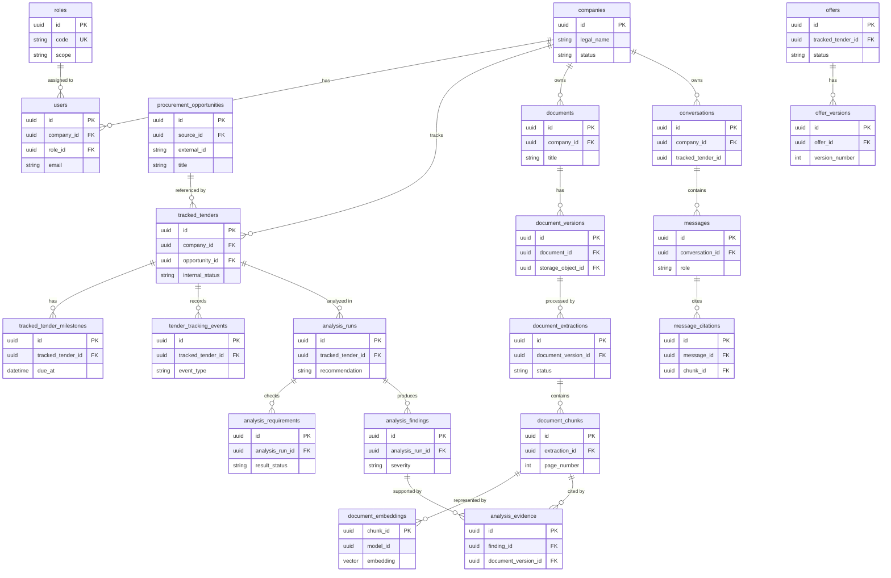

# Data Architecture & Persistence Layer

The current data layer is versioned by Alembic. Identity, authorization, and non-vector product schemas are migrated; the processing-job ORM/lifecycle and tenant authorization helpers are implemented, while feature-domain ORM mappings, services, and APIs remain planned work.

> **Status:** the logical model and physical-schema defaults are approved. Revisions `0002_relational_rbac` through `0006_foundation_jobs_permissions` are implemented and validated. Vector persistence remains gated on selection of an embedding model and dimension.

## Database Configuration

| Service/Module | DB Type | Profile | Driver | Connection | Migration Tool |
|---|---|---|---|---|---|
| Backend | PostgreSQL 16 | Local development | asyncpg through SQLAlchemy AsyncSession | Environment-configured PostgreSQL URL; Compose uses the `db` host | Alembic |
| Vector persistence | PostgreSQL with pgvector image available | Local development | PostgreSQL driver; no vector ORM model currently exists | Same PostgreSQL database | Alembic; vector extension and vector schema are not yet enabled by the existing migration |
| Tests | Not asserted here | Test | See test configuration | Verify `backend/app/tests/conftest.py` before fixing a canonical test database | Alembic migration tests exist |

Schema creation is migration-driven. Revisions `0001` and `0002` create identity, audit, and relational RBAC; revisions `0003` through `0005` create the non-vector product schema. SQLAlchemy ORM mappings and application services for product domains remain to be implemented.

## Data Ownership per Service

| Service/Module | Tables Owned Today / Proposed | ORM Framework | Caching | Notes |
|---|---|---|---|---|
| Identity and company administration | Today: `companies`, `users`, `refresh_tokens`, `roles`, `permissions`, `role_permissions` | SQLAlchemy async | No entity cache found | Revision `0002_relational_rbac` backfills current role values and runtime authorization reads persisted permission grants. |
| Audit | Today: `audit_logs` | SQLAlchemy async | No entity cache found | Audit event metadata is JSONB on PostgreSQL. |
| AI provider policy | Schema migrated: `ai_providers`, `ai_models`, `company_ai_model_policies`, `user_ai_preferences` | SQLAlchemy async, mappings pending | None planned | Provider credentials remain in server environment or a secret manager, not in these tables. |
| Procurement source and tracking | Schema migrated: `procurement_sources`, `procurement_buyers`, `procurement_opportunities`, `source_documents`, `tracked_tenders`, `tracked_tender_milestones`, `tender_tracking_events` | SQLAlchemy async, mappings pending | Source opportunity data may be refreshed and cached in PostgreSQL; freshness must be explicit | Public source facts are separate from each company's private tracking state. |
| Company documents and RAG | Schema migrated: `document_categories`, `storage_objects`, `documents`, `document_versions`, `document_extractions`, `document_chunks`, `document_processing_jobs`, `tender_documents`; embeddings deferred | SQLAlchemy async, mappings pending | No application cache planned initially | Use private local storage for development and private object storage in production; PostgreSQL holds metadata and extracted text. |
| Analysis | Schema migrated: `analysis_runs`, `analysis_requirements`, `analysis_findings`, `analysis_evidence`, `analysis_decisions` | SQLAlchemy async, mappings pending | None planned | Each run is immutable evidence of a particular ruleset/model execution; decisions are separate human records. |
| Chat | Schema migrated: `conversations`, `messages`, `message_citations` | SQLAlchemy async, mappings pending | None planned | Conversation ownership and any linked tender must be checked against the authenticated company. |
| Offers | Schema migrated: `offers`, `offer_versions`, `offer_checklist_items`, `offer_documents` | SQLAlchemy async, mappings pending | None planned | Generated binaries are stored as private storage objects, not as database blobs. |
| Background processing | Job schema and lifecycle service: `document_processing_jobs`; analysis runs also carry their own processing state | SQLAlchemy async | No broker; PostgreSQL row locks and lease expiry | The worker dispatches registered handlers, reclaims expired leases, and persists retry/failure states. Product handlers are deferred to their feature phases. |

## Entity Model

### Implemented schema

Revision `0001_initial_identity` created the original identity and audit tables.
Revision `0002_relational_rbac` moves user roles and grants into relational tables.

| Table | Implemented fields | Source |
|---|---|---|
| `companies` | `id UUID PK`; `legal_name VARCHAR(200) NOT NULL`; `display_name VARCHAR(200) NULL`; `tax_id VARCHAR(30) NULL UNIQUE`; `email VARCHAR(255) NULL`; `phone VARCHAR(40) NULL`; `address TEXT NULL`; `status enum NOT NULL`; `created_at TIMESTAMPTZ NOT NULL`; `updated_at TIMESTAMPTZ NOT NULL`; `deactivated_at TIMESTAMPTZ NULL`. | `backend/app/models/company.py` |
| `roles` | `id UUID PK`; `code VARCHAR(80) NOT NULL UNIQUE`; `name VARCHAR(120) NOT NULL`; `scope VARCHAR(20) NOT NULL`; `is_system BOOLEAN NOT NULL`; `created_at TIMESTAMPTZ NOT NULL`; `updated_at TIMESTAMPTZ NOT NULL`. Scope is `platform` or `company`. | `backend/app/models/role.py` |
| `permissions` | `id UUID PK`; `code VARCHAR(120) NOT NULL UNIQUE`; `description VARCHAR(300) NOT NULL`; `created_at TIMESTAMPTZ NOT NULL`. | `backend/app/models/permission.py` |
| `role_permissions` | Composite primary key `(role_id, permission_id)`; each column is a cascading FK to its role or permission; `created_at TIMESTAMPTZ NOT NULL`. | `backend/app/models/role_permission.py` |
| `users` | `id UUID PK`; `company_id UUID NULL FK companies.id`; `role_id UUID NOT NULL`; `role_scope VARCHAR(20) NOT NULL`; unique required email; required first/last name and password hash; `status enum NOT NULL`; `must_change_password BOOLEAN NOT NULL`; `failed_login_attempts INTEGER NOT NULL`; optional `locked_until`, `last_login_at`, and `deactivated_at`; timestamps. Composite FK `(role_id, role_scope)` references `(roles.id, roles.scope)`; a check requires platform scope iff `company_id` is null. | `backend/app/models/user.py` |
| `refresh_tokens` | `id UUID PK`; `user_id UUID NOT NULL FK users.id`; `token_hash VARCHAR(255) NOT NULL UNIQUE`; `family_id UUID NOT NULL`; `created_at TIMESTAMPTZ NOT NULL`; `expires_at TIMESTAMPTZ NOT NULL`; `revoked_at TIMESTAMPTZ NULL`; `replaced_by_id UUID NULL FK refresh_tokens.id`; `user_agent VARCHAR(512) NULL`; `ip_address VARCHAR(64) NULL`; `reuse_detected_at TIMESTAMPTZ NULL`. Raw refresh tokens are not stored. | `backend/app/models/refresh_token.py` |
| `audit_logs` | `id UUID PK`; `actor_user_id UUID NULL FK users.id`; `company_id UUID NULL FK companies.id`; `action VARCHAR(100) NOT NULL`; `entity_type VARCHAR(100) NOT NULL`; `entity_id VARCHAR(36) NULL`; `occurred_at TIMESTAMPTZ NOT NULL`; `ip_address VARCHAR(64) NULL`; `user_agent VARCHAR(512) NULL`; `metadata JSONB NULL` on PostgreSQL. `entity_type` and `entity_id` are intentionally a generic audit reference, not a foreign key. | `backend/app/models/audit_log.py` |

SQLAlchemy models are declared in `backend/app/models/`; service functions manage transactions explicitly through `AsyncSession` and `commit`/`rollback`. No repository abstraction or declarative transaction boundary was found. Persistent databases still require `alembic upgrade head` before running the updated application.

### Approved normalized target schema

This is a full logical target for the modules described in the product specification, not a migration script. Identifiers are UUIDs unless otherwise stated. Every table should also have an appropriate primary key, foreign keys, `created_at`/`updated_at` timestamps where mutable, indexes for actual query patterns, and explicit deletion/retention rules. Fields below are the proposed business columns; constraints named in the notes are part of the design.

#### Identity, authorization, AI policy

1. **`companies`** — retain the current entity. Add no AI credentials or mutable procurement fields here.
   - `id UUID PK`
   - `legal_name VARCHAR(200) NOT NULL`
   - `display_name VARCHAR(200) NULL`
   - `tax_id VARCHAR(30) NULL UNIQUE`
   - `email VARCHAR(255) NULL`
   - `phone VARCHAR(40) NULL`
   - `address TEXT NULL`
   - `status company_status NOT NULL`
   - `created_at TIMESTAMPTZ NOT NULL`
   - `updated_at TIMESTAMPTZ NOT NULL`
   - `deactivated_at TIMESTAMPTZ NULL`

2. **`roles`** — platform-defined roles initially; tenant-custom roles can be added later with an explicit company scope.
   - `id UUID PK`
   - `code VARCHAR(80) NOT NULL UNIQUE`
   - `name VARCHAR(120) NOT NULL`
   - `scope VARCHAR(20) NOT NULL` (`platform` or `company`)
   - `is_system BOOLEAN NOT NULL`
   - `created_at TIMESTAMPTZ NOT NULL`
   - `updated_at TIMESTAMPTZ NOT NULL`

3. **`permissions`**
   - `id UUID PK`
   - `code VARCHAR(120) NOT NULL UNIQUE`
   - `description VARCHAR(300) NOT NULL`
   - `created_at TIMESTAMPTZ NOT NULL`

4. **`role_permissions`** — many-to-many mapping; composite primary key `(role_id, permission_id)`.
   - `role_id UUID NOT NULL`
   - `role_scope VARCHAR(20) NOT NULL`
   - `permission_id UUID NOT NULL FK permissions.id`
   - `created_at TIMESTAMPTZ NOT NULL`

5. **`users`** — one role per user remains consistent with the current application.
   - `id UUID PK`
   - `company_id UUID NULL FK companies.id`
   - `role_id UUID NOT NULL FK roles.id`
   - `email VARCHAR(255) NOT NULL UNIQUE` (normalized before storage)
   - `first_name VARCHAR(100) NOT NULL`
   - `last_name VARCHAR(100) NOT NULL`
   - `password_hash TEXT NOT NULL`
   - `status user_status NOT NULL`
   - `must_change_password BOOLEAN NOT NULL`
   - `failed_login_attempts INTEGER NOT NULL`
   - `locked_until TIMESTAMPTZ NULL`
   - `last_login_at TIMESTAMPTZ NULL`
   - `created_at TIMESTAMPTZ NOT NULL`
   - `updated_at TIMESTAMPTZ NOT NULL`
   - `deactivated_at TIMESTAMPTZ NULL`
   - Composite FK `(role_id, role_scope)` references `(roles.id, roles.scope)`.
   - A check constraint requires platform scope iff `company_id` is null.

6. **`refresh_tokens`** — retain current fields and constraints.
   - `id UUID PK`; `user_id UUID NOT NULL FK users.id`; `token_hash VARCHAR(255) NOT NULL UNIQUE`; `family_id UUID NOT NULL`; `created_at TIMESTAMPTZ NOT NULL`; `expires_at TIMESTAMPTZ NOT NULL`; `revoked_at TIMESTAMPTZ NULL`; `replaced_by_id UUID NULL FK refresh_tokens.id`; `user_agent VARCHAR(512) NULL`; `ip_address VARCHAR(64) NULL`; `reuse_detected_at TIMESTAMPTZ NULL`.

7. **`audit_logs`** — retain current audit fields; use JSONB only for variable, filtered event metadata.
   - `id UUID PK`; `actor_user_id UUID NULL FK users.id`; `company_id UUID NULL FK companies.id`; `action VARCHAR(100) NOT NULL`; `entity_type VARCHAR(100) NOT NULL`; `entity_id VARCHAR(36) NULL`; `occurred_at TIMESTAMPTZ NOT NULL`; `ip_address VARCHAR(64) NULL`; `user_agent VARCHAR(512) NULL`; `metadata JSONB NULL`.

8. **`ai_providers`** — provider catalog, not credentials.
   - `id UUID PK`
   - `code VARCHAR(60) NOT NULL UNIQUE` (for example `ollama` or a selected hosted provider)
   - `name VARCHAR(120) NOT NULL`
   - `provider_type VARCHAR(30) NOT NULL`
   - `is_enabled BOOLEAN NOT NULL`
   - `created_at TIMESTAMPTZ NOT NULL`
   - `updated_at TIMESTAMPTZ NOT NULL`

9. **`ai_models`**
   - `id UUID PK`
   - `provider_id UUID NOT NULL FK ai_providers.id`
   - `model_code VARCHAR(160) NOT NULL`
   - `display_name VARCHAR(160) NOT NULL`
   - `supports_chat BOOLEAN NOT NULL`
   - `supports_embeddings BOOLEAN NOT NULL`
   - `supports_tools BOOLEAN NOT NULL`
   - `context_window INTEGER NULL`
   - `embedding_dimension INTEGER NULL`
   - `is_enabled BOOLEAN NOT NULL`
   - `created_at TIMESTAMPTZ NOT NULL`
   - `updated_at TIMESTAMPTZ NOT NULL`
   - `UNIQUE(provider_id, model_code)`. Do not assume chat and embedding models are interchangeable.

10. **`company_ai_model_policies`** — which models the company permits and its defaults.
    - `company_id UUID NOT NULL FK companies.id`
    - `model_id UUID NOT NULL FK ai_models.id`
    - `enabled BOOLEAN NOT NULL`
    - `allowed_for_chat BOOLEAN NOT NULL`
    - `allowed_for_embeddings BOOLEAN NOT NULL`
    - `is_default_chat BOOLEAN NOT NULL`
    - `is_default_embedding BOOLEAN NOT NULL`
    - `updated_by UUID NULL FK users.id`
    - `created_at TIMESTAMPTZ NOT NULL`
    - `updated_at TIMESTAMPTZ NOT NULL`
    - Composite primary key `(company_id, model_id)`. Add partial unique indexes so a company has at most one default chat model and one default embedding model.
    - A default chat model must be enabled and allowed for chat; a default embedding model must be enabled and allowed for embeddings.

11. **`user_ai_preferences`**
    - `user_id UUID PK FK users.id`
    - `preferred_chat_model_id UUID NULL FK ai_models.id`
    - `updated_at TIMESTAMPTZ NOT NULL`
    - The service must verify the model is enabled by the user's company. Embedding choice is company-controlled to avoid accidental mixed vector spaces and unnecessary reindexing.

#### Public procurement catalog and private tracking

12. **`procurement_sources`**
    - `id UUID PK`
    - `code VARCHAR(60) NOT NULL UNIQUE`
    - `name VARCHAR(160) NOT NULL`
    - `base_url TEXT NOT NULL`
    - `is_enabled BOOLEAN NOT NULL`
    - `created_at TIMESTAMPTZ NOT NULL`
    - `updated_at TIMESTAMPTZ NOT NULL`
    - Store secrets or API credentials outside this table.

13. **`procurement_buyers`** — source organizations, shared public catalog.
    - `id UUID PK`
    - `source_id UUID NOT NULL FK procurement_sources.id`
    - `external_id VARCHAR(160) NOT NULL`
    - `legal_name VARCHAR(240) NOT NULL`
    - `region_code VARCHAR(40) NULL`
    - `created_at TIMESTAMPTZ NOT NULL`
    - `updated_at TIMESTAMPTZ NOT NULL`
    - `UNIQUE(source_id, external_id)`.

14. **`procurement_opportunities`** — globally shared public/source facts, not private company decisions.
    - `id UUID PK`
    - `source_id UUID NOT NULL FK procurement_sources.id`
    - `buyer_id UUID NULL FK procurement_buyers.id`
    - `external_id VARCHAR(180) NOT NULL`
    - `title VARCHAR(500) NOT NULL`
    - `description TEXT NULL`
    - `source_status VARCHAR(80) NULL`
    - `estimated_amount NUMERIC(18,2) NULL`
    - `currency_code CHAR(3) NULL`
    - `published_at TIMESTAMPTZ NULL`
    - `closing_at TIMESTAMPTZ NULL`
    - `source_url TEXT NOT NULL`
    - `source_payload JSONB NULL` (latest unmodified source response for connector troubleshooting only)
    - `source_hash VARCHAR(128) NULL`
    - `last_synced_at TIMESTAMPTZ NULL`
    - `created_at TIMESTAMPTZ NOT NULL`
    - `updated_at TIMESTAMPTZ NOT NULL`
    - `UNIQUE(source_id, external_id)`. Extracted business fields stay in typed columns; JSONB is not the primary business schema.

15. **`source_documents`** — documents advertised by the public source.
    - `id UUID PK`
    - `opportunity_id UUID NOT NULL FK procurement_opportunities.id`
    - `external_id VARCHAR(180) NULL`
    - `title VARCHAR(500) NOT NULL`
    - `source_url TEXT NOT NULL`
    - `media_type VARCHAR(160) NULL`
    - `source_updated_at TIMESTAMPTZ NULL`
    - `last_fetched_at TIMESTAMPTZ NULL`
    - `storage_object_id UUID NULL FK storage_objects.id`
    - `created_at TIMESTAMPTZ NOT NULL`
    - `updated_at TIMESTAMPTZ NOT NULL`
    - Add a partial unique index on `(opportunity_id, external_id)` when `external_id IS NOT NULL`.

16. **`tracked_tenders`** — company-private relationship to a shared public opportunity.
    - `id UUID PK`
    - `company_id UUID NOT NULL FK companies.id`
    - `opportunity_id UUID NOT NULL FK procurement_opportunities.id`
    - `assigned_user_id UUID NULL FK users.id`
    - `created_by UUID NOT NULL FK users.id`
    - `internal_status VARCHAR(40) NOT NULL`
    - `priority VARCHAR(20) NOT NULL`
    - `decision_status VARCHAR(30) NOT NULL`
    - `archived_at TIMESTAMPTZ NULL`
    - `created_at TIMESTAMPTZ NOT NULL`
    - `updated_at TIMESTAMPTZ NOT NULL`
    - `UNIQUE(company_id, opportunity_id)`. Treat archival as the reversible removal operation; following an archived opportunity restores this row rather than creating a duplicate. Constrain assigned and creator users to the same company using composite foreign keys.

17. **`tracked_tender_milestones`** — private/custom dates and reminders for a company's tracked opportunity.
    - `id UUID PK`
    - `company_id UUID NOT NULL FK companies.id`
    - `tracked_tender_id UUID NOT NULL FK tracked_tenders.id`
    - `milestone_type VARCHAR(60) NOT NULL`
    - `title VARCHAR(240) NOT NULL`
    - `due_at TIMESTAMPTZ NOT NULL`
    - `source_kind VARCHAR(20) NOT NULL` (source, user, or system)
    - `status VARCHAR(30) NOT NULL`
    - `created_by UUID NULL FK users.id`
    - `created_at TIMESTAMPTZ NOT NULL`
    - `updated_at TIMESTAMPTZ NOT NULL`
    - Keep public source dates on the public opportunity or source document, and company-specific overrides/reminders here.

18. **`tender_tracking_events`** — append-only private history of tracking changes.
    - `id UUID PK`
    - `company_id UUID NOT NULL FK companies.id`
    - `tracked_tender_id UUID NOT NULL FK tracked_tenders.id`
    - `actor_user_id UUID NULL FK users.id`
    - `event_type VARCHAR(80) NOT NULL`
    - `from_status VARCHAR(40) NULL`
    - `to_status VARCHAR(40) NULL`
    - `note TEXT NULL`
    - `occurred_at TIMESTAMPTZ NOT NULL`
    - `metadata JSONB NULL` for event-specific details only.

#### Private documents and RAG

19. **`document_categories`**
    - `id UUID PK`
    - `code VARCHAR(80) NOT NULL UNIQUE`
    - `name VARCHAR(160) NOT NULL`
    - `description VARCHAR(300) NULL`
    - `is_active BOOLEAN NOT NULL`
    - `created_at TIMESTAMPTZ NOT NULL`

20. **`storage_objects`** — object-store metadata; never store file bytes in PostgreSQL.
    - `id UUID PK`
    - `storage_provider VARCHAR(60) NOT NULL`
    - `object_key TEXT NOT NULL UNIQUE`
    - `sha256 CHAR(64) NOT NULL`
    - `byte_size BIGINT NOT NULL`
    - `media_type VARCHAR(160) NOT NULL`
    - `created_at TIMESTAMPTZ NOT NULL`
    - Do not make checksum globally unique unless cross-tenant deduplication has been explicitly threat-modeled.

21. **`documents`** — company-owned document identity and metadata.
    - `id UUID PK`
    - `company_id UUID NOT NULL FK companies.id`
    - `category_id UUID NOT NULL FK document_categories.id`
    - `created_by UUID NOT NULL FK users.id`
    - `title VARCHAR(300) NOT NULL`
    - `document_kind VARCHAR(40) NOT NULL` (company, tender, or generated)
    - `status VARCHAR(30) NOT NULL`
    - `deleted_at TIMESTAMPTZ NULL` — logical deletion only; retain version provenance and historical analysis evidence.
    - `created_at TIMESTAMPTZ NOT NULL`
    - `updated_at TIMESTAMPTZ NOT NULL`

22. **`document_versions`** — immutable uploaded or generated revisions.
    - `id UUID PK`
    - `document_id UUID NOT NULL FK documents.id`
    - `version_number INTEGER NOT NULL`
    - `storage_object_id UUID NOT NULL FK storage_objects.id`
    - `source_document_id UUID NULL FK source_documents.id`
    - `original_filename VARCHAR(255) NOT NULL`
    - `created_by UUID NOT NULL FK users.id`
    - `created_at TIMESTAMPTZ NOT NULL`
    - `UNIQUE(document_id, version_number)`.

23. **`tender_documents`** — link a company-owned document to a company-tracked opportunity.
    - `company_id UUID NOT NULL FK companies.id`
    - `tracked_tender_id UUID NOT NULL FK tracked_tenders.id`
    - `document_id UUID NOT NULL FK documents.id`
    - `document_role VARCHAR(40) NOT NULL` (administrative, technical, annex, clarification, company evidence, other)
    - `linked_by UUID NOT NULL FK users.id`
    - `linked_at TIMESTAMPTZ NOT NULL`
    - Composite primary key `(tracked_tender_id, document_id)`. Use composite foreign keys to enforce that both referenced records have the same `company_id`.

24. **`document_extractions`** — versioned output of a parser/OCR run.
    - `id UUID PK`
    - `document_version_id UUID NOT NULL FK document_versions.id`
    - `extractor_code VARCHAR(80) NOT NULL`
    - `extractor_version VARCHAR(80) NOT NULL`
    - `status VARCHAR(30) NOT NULL`
    - `text_storage_object_id UUID NULL FK storage_objects.id`
    - `metadata JSONB NULL` for parser-specific measurements, not core requirements
    - `error_code VARCHAR(100) NULL`
    - `started_at TIMESTAMPTZ NULL`
    - `completed_at TIMESTAMPTZ NULL`
    - `created_at TIMESTAMPTZ NOT NULL`
    - `UNIQUE(document_version_id, extractor_code, extractor_version)`.

25. **`document_chunks`** — searchable fragments with source location.
    - `id UUID PK`
    - `extraction_id UUID NOT NULL FK document_extractions.id`
    - `chunk_index INTEGER NOT NULL`
    - `page_number INTEGER NULL`
    - `section_label VARCHAR(240) NULL`
    - `content TEXT NOT NULL`
    - `content_hash CHAR(64) NOT NULL`
    - `token_count INTEGER NULL`
    - `start_offset INTEGER NULL`
    - `end_offset INTEGER NULL`
    - `UNIQUE(extraction_id, chunk_index)`.

26. **`document_embeddings`** — vector output is separate from chunk text and keyed by embedding model.
    - `chunk_id UUID NOT NULL FK document_chunks.id`
    - `model_id UUID NOT NULL FK ai_models.id`
    - `embedding VECTOR NOT NULL`
    - `created_at TIMESTAMPTZ NOT NULL`
    - Composite primary key `(chunk_id, model_id)`.
    - Before implementation, select one embedding model and dimension for the MVP; define the pgvector dimension and index in the migration. Changing embedding models requires re-embedding and should not silently mix vector spaces.

27. **`document_processing_jobs`** — retryable background work for extraction and indexing.
    - `id UUID PK`
    - `company_id UUID NOT NULL FK companies.id`
    - `document_version_id UUID NOT NULL FK document_versions.id`
    - `requested_by UUID NULL FK users.id`
    - `job_type VARCHAR(40) NOT NULL`
    - `status VARCHAR(30) NOT NULL`
    - `attempt_count INTEGER NOT NULL`
    - `max_attempts INTEGER NOT NULL`
    - `idempotency_key VARCHAR(180) NOT NULL UNIQUE`
    - `available_at TIMESTAMPTZ NOT NULL`
    - `started_at TIMESTAMPTZ NULL`
    - `completed_at TIMESTAMPTZ NULL`
    - `last_error_code VARCHAR(100) NULL`
    - `created_at TIMESTAMPTZ NOT NULL`
    - The worker must derive/verify tenant ownership from the referenced document version and enforce matching `company_id`.

#### Analysis, chat, and offers

28. **`analysis_runs`** — one immutable execution of an analysis.
    - `id UUID PK`
    - `company_id UUID NOT NULL FK companies.id`
    - `tracked_tender_id UUID NOT NULL FK tracked_tenders.id`
    - `requested_by UUID NOT NULL FK users.id`
    - `chat_model_id UUID NULL FK ai_models.id`
    - `embedding_model_id UUID NULL FK ai_models.id`
    - `prompt_version VARCHAR(80) NOT NULL`
    - `ruleset_version VARCHAR(80) NOT NULL`
    - `status VARCHAR(30) NOT NULL`
    - `recommendation VARCHAR(30) NULL` (GO, NO_GO, REVIEW_REQUIRED)
    - `executive_summary TEXT NULL`
    - `report_storage_object_id UUID NULL FK storage_objects.id`
    - `started_at TIMESTAMPTZ NULL`
    - `completed_at TIMESTAMPTZ NULL`
    - `failure_code VARCHAR(100) NULL`
    - `created_at TIMESTAMPTZ NOT NULL`
    - Use composite foreign keys to ensure the tracked tender and requester belong to the same company.

29. **`analysis_requirements`** — extracted requirements and their result for a specific run.
    - `id UUID PK`
    - `analysis_run_id UUID NOT NULL FK analysis_runs.id`
    - `requirement_code VARCHAR(100) NULL`
    - `category_code VARCHAR(60) NOT NULL`
    - `requirement_text TEXT NOT NULL`
    - `is_mandatory BOOLEAN NOT NULL`
    - `result_status VARCHAR(30) NOT NULL` (compliant, non_compliant, unverified)
    - `confidence NUMERIC(5,4) NULL`
    - `sort_order INTEGER NOT NULL`
    - `created_at TIMESTAMPTZ NOT NULL`

30. **`analysis_findings`**
    - `id UUID PK`
    - `analysis_run_id UUID NOT NULL FK analysis_runs.id`
    - `finding_type VARCHAR(60) NOT NULL`
    - `dimension_code VARCHAR(60) NOT NULL`
    - `severity VARCHAR(30) NOT NULL`
    - `title VARCHAR(300) NOT NULL`
    - `explanation TEXT NOT NULL`
    - `result_status VARCHAR(30) NOT NULL`
    - `sort_order INTEGER NOT NULL`
    - `created_at TIMESTAMPTZ NOT NULL`

31. **`analysis_evidence`** — evidence is traceable to a versioned source and optional RAG chunk.
    - `id UUID PK`
    - `finding_id UUID NULL FK analysis_findings.id`
    - `requirement_id UUID NULL FK analysis_requirements.id`
    - `document_version_id UUID NOT NULL FK document_versions.id`
    - `chunk_id UUID NULL FK document_chunks.id`
    - `page_number INTEGER NULL`
    - `quoted_text TEXT NOT NULL`
    - `evidence_kind VARCHAR(30) NOT NULL` (supports, contradicts, context)
    - `created_at TIMESTAMPTZ NOT NULL`
    - Add a check constraint requiring exactly one of `finding_id` or `requirement_id`.

32. **`analysis_decisions`** — human decision history; do not overwrite prior decisions.
    - `id UUID PK`
    - `analysis_run_id UUID NOT NULL FK analysis_runs.id`
    - `decided_by UUID NOT NULL FK users.id`
    - `decision VARCHAR(30) NOT NULL` (GO, NO_GO, REVIEW_REQUIRED)
    - `reason TEXT NOT NULL`
    - `decided_at TIMESTAMPTZ NOT NULL`

33. **`conversations`**
    - `id UUID PK`
    - `company_id UUID NOT NULL FK companies.id`
    - `created_by UUID NOT NULL FK users.id`
    - `tracked_tender_id UUID NULL FK tracked_tenders.id`
    - `title VARCHAR(240) NULL`
    - `context_scope VARCHAR(30) NOT NULL`
    - `status VARCHAR(30) NOT NULL`
    - `deleted_at TIMESTAMPTZ NULL` — logical deletion; retain audit and referenced historical evidence.
    - `created_at TIMESTAMPTZ NOT NULL`
    - `updated_at TIMESTAMPTZ NOT NULL`
    - A conversation linked to a tender must be constrained to the same company.

34. **`messages`**
    - `id UUID PK`
    - `conversation_id UUID NOT NULL FK conversations.id`
    - `sequence_number INTEGER NOT NULL`
    - `role VARCHAR(20) NOT NULL` (system, user, assistant, tool)
    - `content TEXT NOT NULL`
    - `model_id UUID NULL FK ai_models.id`
    - `status VARCHAR(30) NOT NULL`
    - `input_tokens INTEGER NULL`
    - `output_tokens INTEGER NULL`
    - `created_at TIMESTAMPTZ NOT NULL`
    - `UNIQUE(conversation_id, sequence_number)`. Avoid storing secrets or unnecessary hidden reasoning in message content.

35. **`message_citations`**
    - `id UUID PK`
    - `message_id UUID NOT NULL FK messages.id`
    - `chunk_id UUID NOT NULL FK document_chunks.id`
    - `citation_order INTEGER NOT NULL`
    - `created_at TIMESTAMPTZ NOT NULL`
    - `UNIQUE(message_id, citation_order)`. Validate at query time that the cited chunk is accessible through the conversation's company and context.

36. **`offers`**
    - `id UUID PK`
    - `company_id UUID NOT NULL FK companies.id`
    - `tracked_tender_id UUID NOT NULL FK tracked_tenders.id`
    - `created_by UUID NOT NULL FK users.id`
    - `title VARCHAR(240) NOT NULL`
    - `status VARCHAR(30) NOT NULL`
    - `deleted_at TIMESTAMPTZ NULL` — logical deletion; preserve versions and audit history.
    - `created_at TIMESTAMPTZ NOT NULL`
    - `updated_at TIMESTAMPTZ NOT NULL`
    - Multiple offers may belong to one tracked tender; no title-based uniqueness constraint is required.

37. **`offer_versions`**
    - `id UUID PK`
    - `offer_id UUID NOT NULL FK offers.id`
    - `version_number INTEGER NOT NULL`
    - `status VARCHAR(30) NOT NULL`
    - `generated_storage_object_id UUID NULL FK storage_objects.id`
    - `created_by UUID NOT NULL FK users.id`
    - `created_at TIMESTAMPTZ NOT NULL`
    - `UNIQUE(offer_id, version_number)`.

38. **`offer_checklist_items`**
    - `id UUID PK`
    - `offer_version_id UUID NOT NULL FK offer_versions.id`
    - `title VARCHAR(300) NOT NULL`
    - `description TEXT NULL`
    - `status VARCHAR(30) NOT NULL`
    - `assigned_user_id UUID NULL FK users.id`
    - `due_at TIMESTAMPTZ NULL`
    - `sort_order INTEGER NOT NULL`
    - `created_at TIMESTAMPTZ NOT NULL`
    - `updated_at TIMESTAMPTZ NOT NULL`

39. **`offer_documents`** — selected document versions included in an offer version.
    - `offer_version_id UUID NOT NULL FK offer_versions.id`
    - `document_version_id UUID NOT NULL FK document_versions.id`
    - `included_by UUID NOT NULL FK users.id`
    - `sort_order INTEGER NOT NULL`
    - `included_at TIMESTAMPTZ NOT NULL`
    - Composite primary key `(offer_version_id, document_version_id)`. Verify company equality through the owning offer and document.

### Approved physical-schema constraints and deletion policy

- Use UUID primary keys and timezone-aware timestamps. Mutable rows receive
  `created_at` and `updated_at`; append-only history rows receive `occurred_at`
  or `created_at`. Timestamp defaults are set by the database.
- Normalize user email before storage and preserve the existing global unique
  email invariant. Keep the current role backfill and scope/company check from
  revision `0002_relational_rbac`.
- Use named `CHECK` constraints for finite state values and numeric invariants:
  non-negative amounts, sizes, counters, offsets, and token counts; positive
  version numbers; confidence in `[0, 1]`; and valid timestamp ordering.
  State values are:
  - Tracked tender: internal status `new`, `reviewing`, `preparing`,
    `submitted`, `awarded`, `not_awarded`, `closed`; priority `low`, `normal`,
    `high`, `urgent`; decision status `pending`, `go`, `no_go`,
    `review_required`.
  - Milestone source `source`, `user`, `system`; milestone status `pending`,
    `completed`, `cancelled`.
  - Document kind `company`, `tender`, `generated`; document, extraction, and
    job status `queued`, `processing`, `completed`, `failed`, with `uploaded`
    and `ready` also allowed for documents. Jobs additionally allow `cancelled`.
  - Analysis status `queued`, `processing`, `completed`, `failed`, `cancelled`;
    requirement/finding result `compliant`, `non_compliant`, `unverified`;
    severity `info`, `low`, `medium`, `high`, `critical`; evidence kind
    `supports`, `contradicts`, `context`; decision `GO`, `NO_GO`,
    `REVIEW_REQUIRED`.
  - Conversation scope `company` or `tender`; conversation status `active` or
    `closed`; message role `system`, `user`, `assistant`, `tool`; message status
    `pending`, `completed`, `failed`.
  - Offer status `draft`, `in_progress`, `ready`, `cancelled`; offer-version
    status `draft`, `generated`, `approved`; checklist status `pending`,
    `in_progress`, `completed`, `blocked`.
- Enforce tenant consistency with composite foreign keys wherever both the
  parent and child carry `company_id`, including tracked-tender assignments,
  document-to-tender links, conversations, analysis runs, and offers. Nested
  records without a stored tenant key inherit ownership through their parent;
  services must resolve that ownership and authorize every read and write.
- Use `RESTRICT` for product relationships that protect provenance or history.
  Use `SET NULL` only for optional actor references. Do not cascade deletion
  through business history. Pure role-permission associations may cascade as
  in the existing RBAC migration.
- MVP removal is logical only: `tracked_tenders.archived_at` is its single
  reversible archive marker; `documents`, `conversations`, and `offers` use
  `deleted_at`. There is no automatic hard purge. Production retention and
  purge periods require a separate deployment decision.
- Add indexes for foreign-key joins and observed list/claim queries, including
  company/status/date access patterns and available job scheduling fields.
  Preserve unique source identifiers and idempotency keys. Do not create
  vector columns or vector indexes until an embedding model and dimension are
  selected.

### Core relationship diagram

<!-- mermaid-checked: every attribute is `<type> <name> [<key>] ["<description>"]` with at most one of PK/FK/UK, no \n in descriptions, no {} in descriptions, every relationship label is double-quoted -->

The full inventory above includes supporting catalogs, join tables, provider policy, storage, job, and offer checklist tables that are intentionally omitted from the core diagram for readability.

## Key Repository Methods

No dedicated repository classes or repository interfaces were found. API route handlers call service functions, and service functions execute SQLAlchemy queries directly using an injected `AsyncSession`. The proposed design should keep persistence queries behind module-specific services initially; repository classes should be introduced only where they clarify reusable query behavior or tenant-boundary enforcement.

| Service/Module | Repository | Notable Methods | Purpose |
|---|---|---|---|
| Current identity and company services | None found; direct SQLAlchemy in `backend/app/services/` | Select/insert/update operations inside service functions | Authentication, account administration, company administration, audit writes |
| Proposed procurement | To be designed | `search_opportunities`, `upsert_source_opportunity`, `track_opportunity`, `list_tracked_tenders` | Separate public source records from tenant tracking and enforce company filters |
| Proposed documents | To be designed | `create_document_version`, `enqueue_processing`, `list_company_documents`, `get_tender_documents` | Tenant-scoped document metadata and processing |
| Proposed RAG | To be designed | `search_chunks(company_id, tracked_tender_id, query_vector, limit)` | Similarity search joined through accessible company documents |
| Proposed analysis | To be designed | `create_analysis_run`, `load_analysis_evidence`, `record_decision` | Immutable run history and traceable evidence |

## Caching Strategy

No shared or distributed application cache was found for database entities. Authentication login rate limiting currently uses process-local memory, so it is not a cache and will not be consistent across multiple backend processes.

For the proposed source integration, persist the latest normalized public opportunity facts and `last_synced_at` in PostgreSQL. Refresh based on documented source limits and use explicit freshness in the UI. Do not cache company-specific analysis results across tenants. RAG vector indexes are persisted search data, not a substitute for authorization checks. Add Redis or an equivalent only when shared rate limits, job brokerage, or measured cache needs require it.

## Data Ownership Boundaries

The current implementation uses one PostgreSQL database with logical separation through foreign keys and service-level company scoping. It is a single database, not database-per-company. The target model keeps that topology and enforces tenant boundaries with `company_id`, composite unique/foreign-key constraints where feasible, and authorization in server-side services. PostgreSQL row-level security can be evaluated as an additional defense, but does not replace application authorization.

The public procurement catalog (`procurement_sources`, `procurement_buyers`, `procurement_opportunities`, and `source_documents`) is shared, read-only source data. Company-specific tracking, uploaded/reused documents, RAG access, conversations, analyses, decisions, and offers belong to one company. The `tracked_tenders` row is the tenant-owned link from a company to a public opportunity. Public source document availability does not grant access to another company's private notes, document corpus, analysis, or offer.

The target schema aims for 3NF for relational business facts: roles, permissions, categories, providers, opportunities, tenant tracking, document versions, findings, and decisions are separate entities with explicit foreign keys. BCNF can be applied where candidate-key constraints permit without obscuring domain behavior. Some proposed child tables repeat `company_id` alongside a parent ID to support composite same-tenant foreign keys and straightforward tenant filtering; this is intentional, controlled redundancy, not a claim that every table is strictly in 3NF. The final review should decide whether to retain those composite tenant keys or derive company ownership through joins. Controlled non-relational data is limited to the latest raw source response and filtered audit/parser metadata; these JSONB values must not replace typed fields used for business rules. Embeddings are derived search data and stay separate from chunk content.

Data/API relationships should use stable internal UUIDs. External procurement IDs are unique only within a source and are not authorization tokens. Company-scoped records must be loaded through the authenticated user's company context; never accept a browser-supplied company identifier as the authority for RAG, analysis, files, or messages.

### Data Classification & Sensitivity

| Entity | Sensitive Fields | Classification | Controls in Place / Required |
|---|---|---|---|
| `companies` | Legal name, tax ID, address, email, phone | PII and business-confidential | Current access is role-protected; production encryption-at-rest and field-level access should be confirmed with hosting. |
| `users` | Email, names, password hash, lockout and login metadata | PII and authentication data | Password hashes are stored, not raw passwords. Restrict access and avoid logging credentials. |
| `refresh_tokens` | Token hashes, IP, user agent | Authentication/security data | Raw refresh token is not stored; enforce expiry and revocation. |
| `audit_logs` | Actor, company, IP, user agent, metadata | PII and security audit data | Filter metadata; define access and retention. |
| `documents`, `document_versions`, `document_chunks`, `document_embeddings` | Company files, extracted text, vector representations | Confidential business data; may include personal data | Private object storage, authorization on every read, tenant-scoped retrieval, retention/deletion policy. |
| `procurement_opportunities`, `source_documents` | Public tender facts and source files | Public source data | Preserve provenance and source URL; verify source terms and freshness. |
| `tracked_tenders`, `tender_tracking_events` | Company status, assignee, internal notes and decisions | Confidential business data and user attribution | Company-only access; audit material decisions and maintain tenant boundary. |
| `analysis_runs`, `analysis_requirements`, `analysis_findings`, `analysis_evidence`, `analysis_decisions` | Analysis outputs, evidence excerpts, human decisions | Confidential business data | Tenant scope, citations to source versions, model/ruleset traceability, human review. |
| `conversations`, `messages`, `message_citations` | User questions, generated content, cited excerpts | Confidential business data; may contain PII | Do not expose prompts or citations across companies; define retention and avoid storing provider secrets. |
| `offers`, `offer_versions`, `offer_checklist_items`, `offer_documents` | Draft bid content and selected evidence | Confidential business data | Private storage, explicit access checks, version history and audit. |
| Provider credentials | API keys and private connection details | Secrets | **Not stored in these tables.** Use server environment in local development and a secret manager in production. |

At-rest encryption, production key management, backup encryption, and any future hard-purge retention period are deployment decisions not proven by the current entity model and must be specified before production. The MVP uses logical deletion and does not automatically purge records or stored files.
