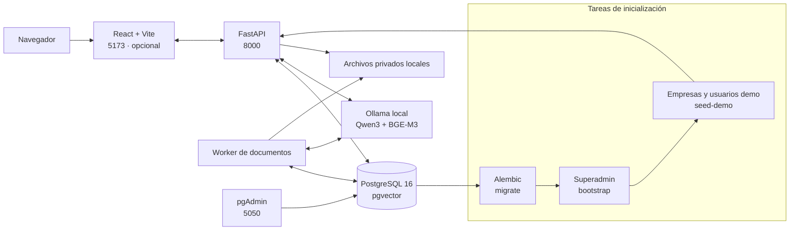
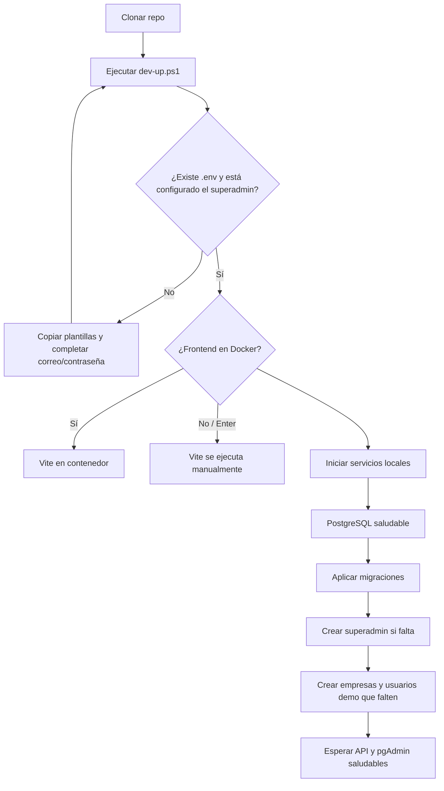

<p align="center">
  
</p>

<h1 align="center">Licitaciones AI</h1>

<p align="center">
  Plataforma multiempresa para organizar oportunidades de licitación y preparar ofertas con apoyo de IA.
</p>

<p align="center">
  
  
  
  
  
</p>

> **Estado del proyecto:** identidad, autenticación, RBAC, empresas y auditoría están implementados. El MVP local incluye carga privada de PDF/DOCX, extracción, embeddings con Ollama y chat con citas. La primera consulta en vivo de una licitación por código ya está conectada a Mercado Público; el seguimiento persistente, descarga de bases, análisis Go/No-Go y ofertas siguen pendientes. No hay despliegue CI/CD a producción.

## ✨ Qué incluye

- 🔐 Inicio de sesión, sesiones, perfil y cambio de contraseña.
- 🧭 Roles `super_admin`, `admin` y `user`, con autorización aplicada en la API.
- 🏢 Separación multiempresa y administración de empresas y usuarios.
- 🧾 Auditoría de acciones administrativas.
- 📄 Repositorio privado de documentos PDF/DOCX con extracción y estado de procesamiento.
- 🤖 Chat local con Ollama, recuperación por empresa y citas cuando hay documentos relevantes.
- 🧪 Datos locales de ejemplo: dos empresas, cada una con un admin y un usuario normal.
- 🐳 Arranque local de PostgreSQL, migraciones, backend, worker y pgAdmin con un script.
- ⚛️ Frontend React/Vite opcional en Docker o ejecutado manualmente con recarga en caliente.

## 🧱 Arquitectura local



Las migraciones crean el esquema relacional, el catálogo Ollama y los vectores pgvector. El worker procesa los documentos subidos y la API solo devuelve contenido del tenant autenticado. El seeder local añade las empresas y usuarios demo después del bootstrap; no está mezclado con las migraciones de esquema.

## 🚀 Clonar e iniciar en Windows

### Requisitos

- Git.
- Docker Desktop iniciado, con Docker Compose v2.
- Ollama local con `qwen3:1.7b` y `bge-m3` disponibles.
- PowerShell.
- Node.js 22+ y npm solo si ejecutarás el frontend manualmente.
- Python 3.12 solo para correr las pruebas fuera de Docker.

### 1. Clonar

```powershell
git clone https://github.com/BigFrankV/Hackatoon.git
Set-Location Hackatoon
```

### 2. Preparar las credenciales locales

Ejecuta el script una vez:

```powershell
.\scripts\dev-up.ps1
```

Si no existen, crea `.env`, `backend/.env` y `frontend/.env` desde sus plantillas. En la primera ejecución puede detenerse para que completes las credenciales iniciales en el `.env` raíz:

| Variable | Qué configurar |
|---|---|
| `BOOTSTRAP_SUPERADMIN_EMAIL` | Correo inicial del superadmin, por ejemplo `admin@hackatoon.dev`. |
| `BOOTSTRAP_SUPERADMIN_PASSWORD` | Contraseña inicial de al menos 12 caracteres. |
| `POSTGRES_PASSWORD` | Sustituye el valor de ejemplo por uno propio. |
| `PGADMIN_DEFAULT_PASSWORD` | Sustituye el valor de ejemplo por uno propio. |

El script genera contraseñas aleatorias para las cuatro cuentas demo si sus variables están vacías. **No genera automáticamente** las contraseñas de PostgreSQL, pgAdmin ni del superadmin: configúralas antes de compartir el `.env` local con alguien.

### 3. Arrancar el entorno

Vuelve a ejecutar:

```powershell
.\scripts\dev-up.ps1
```

El script pregunta `Iniciar frontend en Docker? (s/N)`:

- Pulsa **Enter** o escribe `N` para dejar Vite manual.
- Escribe `S` para iniciar también el frontend en Docker.

El arranque espera que la API y pgAdmin estén saludables. El orden es: PostgreSQL → migraciones → superadmin → datos demo → API y pgAdmin.
También inicia el worker para procesar la cola de documentos. En `.env` raíz, `OLLAMA_BASE_URL` por defecto apunta a `http://host.docker.internal:11434`.

Si elegiste frontend manual, en otra ventana de PowerShell:

```powershell
Set-Location .\frontend
npm ci
npm run dev
```

### 🔄 Flujo de inicio



## 🔑 Accesos locales

| Servicio/cuenta | Usuario | Contraseña inicial |
|---|---|---|
| pgAdmin · http://localhost:5050 | `pgadmin@hackatoon.dev` | Variable `PGADMIN_DEFAULT_PASSWORD` del `.env`. |
| Superadmin | `admin@hackatoon.dev` (o el correo configurado) | Variable `BOOTSTRAP_SUPERADMIN_PASSWORD` del `.env`. |
| Admin Demo Norte | `admin.norte@hackatoon.dev` | `DEV_SEED_NORTH_ADMIN_PASSWORD`. |
| Usuario Demo Norte | `usuario.norte@hackatoon.dev` | `DEV_SEED_NORTH_USER_PASSWORD`. |
| Admin Demo Sur | `admin.sur@hackatoon.dev` | `DEV_SEED_SOUTH_ADMIN_PASSWORD`. |
| Usuario Demo Sur | `usuario.sur@hackatoon.dev` | `DEV_SEED_SOUTH_USER_PASSWORD`. |

Las contraseñas reales viven únicamente en el `.env` local. El superadmin y las cuentas demo solicitan cambio de contraseña al primer inicio. Las cuentas demo tienen correos y roles estables entre clones, pero cada computadora genera sus propias contraseñas.

Para habilitar la consulta por código, configura `PROCUREMENT_API_TICKET` en `backend/.env`. El ticket se usa solo desde el backend; no lo compartas ni lo pongas en el frontend. La primera versión consulta y muestra la ficha, pero todavía no guarda seguimiento ni descarga documentos.

En pgAdmin aparece el servidor **Licitaciones local**. Si pide la contraseña de la base al conectarse, usa `POSTGRES_PASSWORD`. La conexión usa `db:5432` dentro de Compose; desde Windows PostgreSQL se publica como `localhost:5432`.

Consulta la [guía de credenciales locales](./CREDENCIALES_DESARROLLO.md) para los detalles de persistencia y cambio de contraseñas.

## 🌐 URLs del entorno

| Servicio | URL |
|---|---|
| Frontend | http://localhost:5173 |
| API | http://localhost:8000 |
| OpenAPI / Swagger | http://localhost:8000/docs |
| Health check | http://localhost:8000/api/v1/health |
| pgAdmin | http://localhost:5050 |
| PostgreSQL desde Windows | `localhost:5432` |

## 🛑 Detener y conservar datos

Desde la raíz del repositorio:

```powershell
docker compose --profile dev --profile jobs --profile frontend down
```

Esto detiene los servicios y conserva los volúmenes de PostgreSQL y pgAdmin. No añadas `--volumes` salvo que quieras borrar la base y los datos guardados de pgAdmin. Un cambio de contraseña en `.env` no actualiza automáticamente una contraseña ya inicializada dentro de un volumen existente.

## 🧰 Pruebas y compilación

### Backend

```powershell
py -3.12 -m venv backend\.venv
backend\.venv\Scripts\python.exe -m pip install -r backend\requirements.txt -r backend\requirements-dev.txt
backend\.venv\Scripts\python.exe -m pytest backend\app\tests -q
backend\.venv\Scripts\ruff.exe check backend\app
```

Las pruebas PostgreSQL de integración usan un esquema temporal dentro de una
base de datos desechable. Configura `TEST_DATABASE_URL` con una URL
`postgresql+asyncpg` de esa base y ejecuta:

```powershell
backend\.venv\Scripts\python.exe -m pytest backend\app\tests\test_postgres_integration.py -m integration -q
```

### Frontend

```powershell
Set-Location frontend
npm ci
npm test
npm run build
```

## 🔒 GitHub y secretos

- **No subas `.env`, `backend/.env`, `frontend/.env` ni `pgadmin/servers.json`.** Contienen credenciales o configuración local y están ignorados por Git.
- Sí se versionan las plantillas `.env.example`, `backend/.env.example` y `frontend/.env.example`, además del script y la plantilla `pgadmin/servers.json.example`.
- Cada colaborador crea su propio `.env` y usa credenciales locales distintas. Para producción, usa un gestor de secretos; no reutilices las claves de desarrollo.
- La configuración Compose y el script son para desarrollo local, no para desplegar a producción.

## 📦 Alcance de despliegue

`scripts/dev-up.ps1` automatiza el **entorno de desarrollo local**. Este repositorio todavía no contiene un pipeline CI/CD ni una configuración de despliegue a nube. La estrategia de producción (hosting, secretos, TLS, backups, CI/CD y dominio) se debe definir por separado.

## 📚 Documentación

- [Guía del proyecto y estado de módulos](./GUIA_PROYECTO.md)
- [Guía de accesos y contraseñas locales](./CREDENCIALES_DESARROLLO.md)
- [Especificación integral del producto](./01_especificacion_integral_licitaciones_ai.md)
- [Especificación de Auth, RBAC y multitenancy](./02_modulo_auth_rbac_multitenancy.md)
